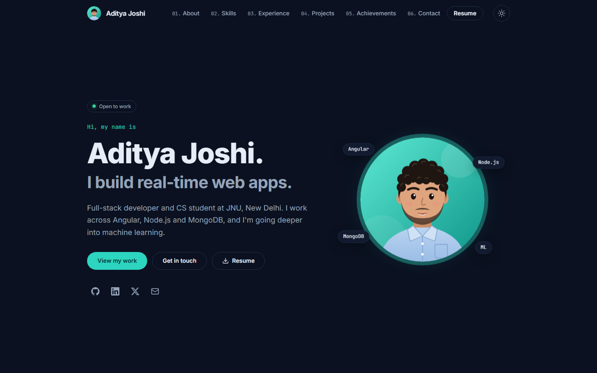

# Aditya Joshi · Portfolio

My personal portfolio: a fast, accessible single-page site built with Angular 21 and prerendered to static HTML.

**Live site: [portfolio-rust-two-47.vercel.app](https://portfolio-rust-two-47.vercel.app)**

[](https://portfolio-rust-two-47.vercel.app)


## Highlights

- **Lighthouse 100** in performance, accessibility, best practices and SEO, on both mobile and desktop (measured on the live site).
- **Prerendered (static site generation):** the page ships as ready-made HTML, so it loads fast and search engines and link previews see the full content.
- **Dark and light theme** that follows the system setting, remembers your choice, and never flashes the wrong theme on load.
- **Accessible:** semantic HTML, full keyboard navigation, visible focus states, AA color contrast, and animations turned off for people who prefer reduced motion.
- **Content lives in typed data files**, not in templates. Adding a project or a job means editing one TypeScript file.
- **Modern Angular:** standalone components, signals, the new `@if` / `@for` control flow, OnPush change detection, and `@defer` to load the contact form only when it scrolls into view.
- **Production hosting setup:** security headers, one-year caching for hashed assets, responsive WebP images, a sitemap, structured data (JSON-LD) and a real 404 page.

## Tech stack

| Area      | Tools                                                               |
| --------- | ------------------------------------------------------------------- |
| Framework | Angular 21 (standalone components, signals, SSG via `@angular/ssr`) |
| Language  | TypeScript (strict)                                                 |
| Styling   | Plain CSS with custom properties (design tokens), no UI library     |
| Fonts     | Inter and JetBrains Mono, self-hosted                               |
| Testing   | Vitest + jsdom                                                      |
| Hosting   | Vercel (static output)                                              |

## What I learned building it

- **Prerendering vs. client-side rendering:** why a static HTML page beats a blank app shell for first load, SEO and link previews, and how Angular's SSG step produces it.
- **Signals and OnPush:** keeping state (theme, active section, form status) in signals so components update only when something they use changes.
- **Accessibility is a checklist, not a feeling:** landmark elements, focus order, contrast checks in both themes, and respecting `prefers-reduced-motion`.
- **Avoiding a theme flash:** applying the saved theme with a tiny inline script before the first paint, before Angular even starts.
- **Hosting details matter:** a static host will happily serve the home page for every URL unless you define routing yourself. I set up Vercel routes so unknown pages return a real 404, plus caching and security headers.

## Run it locally

Requires Node.js 22.

```bash
npx npm@11 install   # npm 10.9 has a bug with these dependencies; npm 11 works
npm start            # dev server at http://localhost:4200
npm test             # unit tests (Vitest)
npm run build        # static site in dist/portfolio/browser
```

## Project structure

```
src/
├── index.html          meta tags, link-preview tags, no-flash theme script
├── styles.css          design tokens (colors, type, spacing), base styles, shared classes
└── app/
    ├── config/         EmailJS keys
    ├── data/           all site content (typed) + nav order
    ├── pages/home/     the single scrolling page
    ├── layout/         navbar (scroll spy, mobile menu), footer, theme toggle
    ├── sections/       hero, about, skills, experience, projects, achievements, contact
    ├── shared/         icon set, section header, project card, scroll-reveal directive
    └── services/       theme, scroll spy, contact (EmailJS)
public/                 avatar, icons, link-preview image, project screenshots, resume, certificates
docs/                   README screenshot
vercel.json             hosting config: security headers, caching, unknown URLs -> 404 page
```

## Editing content

All text lives in `src/app/data/`, so no HTML changes are needed:

| File              | What it holds                                                   |
| ----------------- | --------------------------------------------------------------- |
| `profile.ts`      | Name, headline, summary, social links, quick facts, resume link |
| `skills.ts`       | Skill groups                                                    |
| `experience.ts`   | Internships and work (the section hides itself while empty)     |
| `projects.ts`     | Projects (set `featured: true` for the large card)              |
| `achievements.ts` | Certifications and leadership roles                             |

**Adding a project screenshot:** put WebP images in `public/projects/<slug>/` (for example 640, 960 and 1280 px wide)
and list them in the project's `image.srcset`.

**Resume:** `public/resume.pdf` is served at `/resume.pdf`. The Resume buttons only appear while `resumeUrl` in
`profile.ts` is set.

<details>
<summary><strong>Contact form setup (EmailJS, optional)</strong></summary>

The form can send messages to your inbox through [EmailJS](https://www.emailjs.com) (free plan: 200 emails/month).
While the three keys are empty, as they are now, the form still validates input but tells visitors to email
directly instead of sending.

1. **Sign up** at https://dashboard.emailjs.com/sign-up.
2. **Add an email service:** _Email Services → Add New Service → Gmail_, connect your Gmail account,
   and copy the **Service ID** (e.g. `service_abc123`).
3. **Create a template:** _Email Templates → Create New Template_, then set:
   - **Subject:** `New portfolio message from {{from_name}}`
   - **Content:**
     ```
     Name: {{from_name}}
     Email: {{reply_to}}

     {{message}}
     ```
   - **To Email:** your own address
   - **Reply To:** `{{reply_to}}` (so pressing "Reply" answers the sender)

   Save and copy the **Template ID** (e.g. `template_xyz789`).

4. **Copy your Public Key:** _Account → General → Public Key_.
5. Paste all three into `src/app/config/emailjs.config.ts`.
6. **Lock it down:** _Account → Security → Allowed origins_, add only the live site's URL
   so nobody else can use the keys.

The keys are designed to be public (they only allow sending through your template). Spam protection on the
site: a hidden honeypot field, a minimum fill time, EmailJS headless-browser blocking, and a limit of one
message per 10 seconds per browser.

</details>

## Contact

- Email: [aditya.adi0310@gmail.com](mailto:aditya.adi0310@gmail.com)
- LinkedIn: [Aditya Joshi](https://www.linkedin.com/in/aditya-joshi-358b2132a)
- GitHub: [@aJoshiG](https://github.com/aJoshiG)

The full plan and progress notes are in [PLAN.md](PLAN.md).
